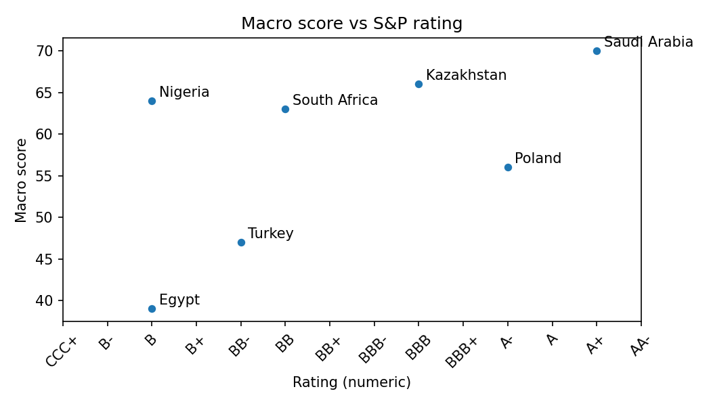

# CEEMEA Sovereign Monitor

A Python tool that tracks macro fundamentals for seven CEEMEA sovereigns and produces an LLM-generated daily morning note for an emerging markets debt team.

**Countries:** Turkey, Egypt, Saudi Arabia, Nigeria, Kazakhstan, South Africa, Poland

## What it does

1. **Macro data pipeline:** pulls six indicators from the World Bank API (GDP growth, inflation, current account, FX reserves, tax revenue, GDP per capita) and general government debt from the IMF World Economic Outlook API, keeping the latest available year (up to 2025) for each country.
2. **Macro strength scorecard:** ranks countries 0–100 on each indicator (percentile rank, with the direction set per indicator, e.g. higher reserves = better, higher inflation = worse) and averages the ranks into one score.
3. **Charts:** scorecard ranking and inflation history.
4. **LLM morning note:** pulls the last 48 hours of economy/markets headlines per country from Google News, combines them with the scorecard, and uses the Claude API to write a short sovereign credit note for portfolio managers.

## Validation against S&P ratings

I tested the scorecard against S&P long-term foreign-currency sovereign ratings (as of 18 Nov 2026) using Spearman rank correlation.

| Version | Rank correlation | p-value |
|---|---|---|
| v1: six macro indicators | 0.58 | 0.18 |
| v2: + GDP per capita | 0.90 | 0.01 |
| v3: + IMF general government debt (replacing patchy World Bank central government debt) | 0.91 | <0.01 |

- **v1 had two clear outliers:** Nigeria scored too high (B-rated; missing debt and tax data meant fewer indicators could penalise it) and Poland too low (A-rated).
- **Fix:** both point to a factor rating agencies weight heavily but the model lacked, income level. Adding GDP per capita (a standard input in agency sovereign methodologies) moved Nigeria from 64 to 54 and Poland from 56 to 61.
- **Second fix:** World Bank debt data was missing for four of the seven countries, so I switched to IMF World Economic Outlook general government debt for all countries (one consistent definition, full coverage).
- **What the remaining gaps show:** with complete data, Kazakhstan (BBB, debt 24% of GDP) still scores above Poland (A-, debt 60%), and Turkey has the lowest debt in the group but is rated BB-. Agencies weight institutions, EU membership, economic diversification and policy credibility, which a purely quantitative scorecard does not capture.
- **Caveats:** n = 7, and the test is in-sample (the model was adjusted on the same countries it was tested on).

*v1 scorecard vs S&P rating, showing the Nigeria and Poland outliers:*

## Fact-checking the LLM output

I checked the sample brief claim by claim (`fact_check.md`). 7 of the 10 claims checked were confirmed. The main failure was **causal linking**: the model merged two unrelated headlines (the rand's seven-month low and ANC coalition talks) into a false cause. One item may have been a stale headline. Next step: make the prompt cite the source headline for each bullet, and filter news by publication date.

## Design choices

- **Caching and retries:** the World Bank API was unreliable (timeouts, 502 errors), so each indicator is saved to CSV as soon as it downloads and only missing indicators are refetched.
- **Stale data rule:** values older than 2020 are excluded from scoring (e.g. Egypt's latest tax revenue figure was from 2015).
- **Prompt design:**
  - The model is told to use *only* the supplied headlines and data, to prevent invented or outdated facts.
  - A fixed structure (summary, then country bullets, then a "Bond/FX read") keeps the daily output consistent.
  - Views are explicitly framed as judgements, separate from reported facts.
  - Macro data is included so news is read against fundamentals.

## Limitations and next steps

- **Qualitative factors:** no measure of institutional strength or policy credibility. Next step: add World Bank Governance Indicators.
- **Scoring bias:** countries with missing data are scored on fewer indicators, which can flatter them (Nigeria still lacks recent tax revenue data). Next steps: a minimum-indicator threshold and heavier weights on debt and reserves.
- **Rank-based scoring ignores magnitude:** 35% inflation scores only one rank below 23%.
- **News coverage:** English-language headlines only. Next step: Arabic and Turkish sources.
- **Market data:** I tested FX volatility (Yahoo Finance) as a free proxy for market stress, but rejected it. The data had errors (a 4% one-day move in the dollar-pegged Saudi riyal), and volatility misses managed depreciation (Turkey's lira fell 16% over the year with very low daily volatility). Next step: Eurobond (EMBI) or CDS spreads from Bloomberg to compare fundamentals with market pricing.
- **Validation:** extend the ratings test to 20+ sovereigns not used in building the model, and test against Eurobond spreads as well as ratings.
- **Data lag:** World Bank data is annual and can lag current prints (e.g. South African inflation in the sample brief). Next step: monthly CPI and reserves.

## Files

| File | Contents |
|---|---|
| `ceemea_sovereign_monitor.ipynb` | Full notebook (data, scorecard, morning note) |
| `ceemea_macro.csv` | Cached World Bank data |
| `scorecard.png`, `inflation.png`, `score_vs_rating.png` | Charts |
| `sample_brief.md` | Example morning note (18 Nov 2026; AI-generated from headlines) |
| `fact_check.md` | Claim-by-claim fact-check of the sample brief against published sources |

## How to run

Open the notebook in Google Colab, add an Anthropic API key as a Colab secret named `ANTHROPIC_API_KEY`, and run all cells.

**Tools:** Python, pandas, requests, matplotlib, feedparser, Anthropic Claude API. Built with AI coding assistance; I chose the countries, indicators, data rules and output format, ran the ratings validation, and debugged the pipeline.
